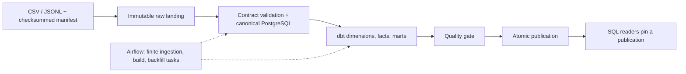
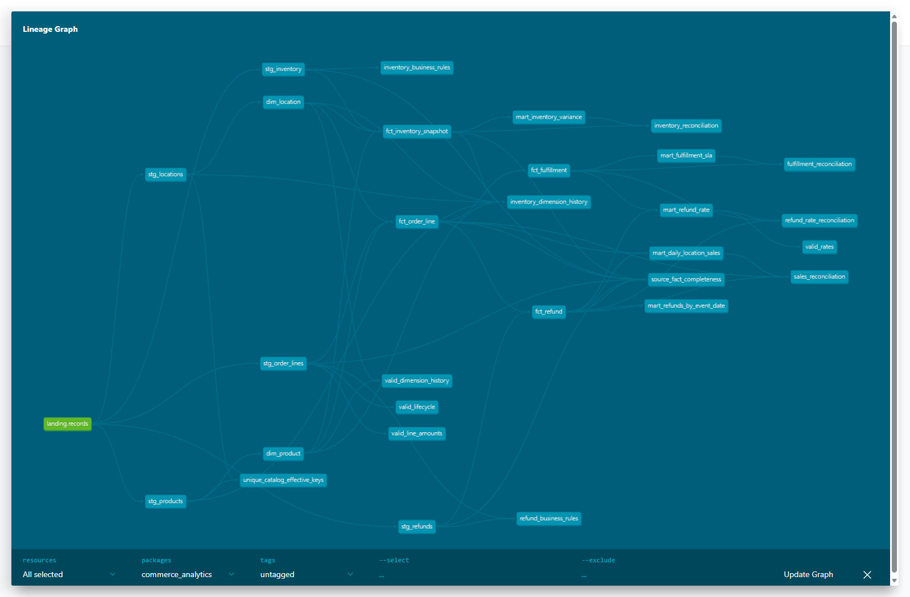

# Commerce Operations Analytics Platform

[](https://github.com/ThePhysic/commerce-operations-analytics/actions/workflows/ci.yml)

A fictional commerce business needs consistent sales, refund, fulfillment, and inventory answers despite duplicate deliveries, late corrections, and changing product/location histories. This batch platform preserves source evidence, validates contracts, builds dbt analytics, and publishes only a complete result that passes its quality gates.

**All business data is deterministic and synthetic.** This is a local portfolio implementation with PostgreSQL as a dedicated analytical store. It makes no claims about real customer traffic, production capacity, or distributed/cloud warehouse experience.

[Architecture](docs/architecture.md) | [Evidence](docs/evidence.md) | [Operations](docs/operations.md) | [Local demo guide](docs/local-demo.md)



## Run the demo

With Docker, Compose v2, and Linux containers, run from the repository root:

```sh
docker compose run --build --rm runner demo
```

This starts local PostgreSQL, generates a seven-day seed-42 workload, builds/tests the warehouse, publishes it, and verifies an identical replay. First-time downloads can take longer than ten minutes. Airflow is optional and stays stopped during this command. [Local setup, SQL access, Airflow, and development commands](docs/local-demo.md).

## Verified evidence snapshot

| Check | Recorded evidence |
| --- | --- |
| Native Python/PostgreSQL suite | 142 passed in 499.24 s during this polish pass |
| dbt quality gate | 16 models + 84 data tests = 100 successful nodes |
| Generated local demo | 140 orders, 189 order lines, 21 refunds; replay preserved counts/totals |
| Historical remote CI | Both jobs passed on `499b8e4`; see [that run](https://github.com/ThePhysic/commerce-operations-analytics/actions/runs/41554399790) |

Local tests and dbt counts were rechecked November 2, 2026 (Pacific); the generated-demo and remote-CI rows preserve historical baseline observations. Revision-specific outcomes and reproduction details are in [evidence](docs/evidence.md). The badge and [Actions workflow](https://github.com/ThePhysic/commerce-operations-analytics/actions/workflows/ci.yml) show the latest available CI state; historical success does not establish a later commit's status.

The measured incremental runs were **slower** than full rebuilds on both recorded workloads: **18.13 s vs 16.94 s**, and **33.16 s vs 22.51 s**. See [raw observations and limitations](docs/evidence/benchmark-notes.md); no speedup or production-scale claim is made.

## A reproducible business answer

Against the [versioned reference fixture](fixtures/reference/) published as of `2024-01-05`:

```sql
select sum(gross_sales_cents) as gross_sales_cents,
       sum(discount_cents) as discount_cents,
       sum(refund_cents) as refund_cents,
       sum(net_sales_cents) as net_sales_cents
from analytics.mart_daily_location_sales;
```

```text
 gross_sales_cents | discount_cents | refund_cents | net_sales_cents
-------------------+----------------+--------------+----------------
              9000 |            600 |         1500 |            6900
```

Amounts are integer cents: net = gross - discounts - refunds attributed to the original sale date. Taxes and tips are outside the source model. [Reproduce this exact fixture result](docs/local-demo.md#reproduce-the-reference-sql-result); the generated demo above has different totals. Multi-query reports must [pin a retained publication](docs/reading-publications.md).

<details>
<summary>Actual dbt lineage from the synthetic reference fixture</summary>



Captured from the running dbt documentation page on November 2, 2026 (Pacific), after a successful reference-fixture publication. [Reproduce the page and capture](docs/local-demo.md#reproduce-the-lineage-screenshot).

</details>

## Explore the project

| Guide | Contents |
| --- | --- |
| [Architecture](docs/architecture.md) | Source boundaries, reconciliation, backfills, atomic publication |
| [Evidence](docs/evidence.md) | Reproducible checks, historical observations, measured limitations |
| [Operations](docs/operations.md) | Shared artifact ownership, scheduler recovery, disposable harness |
| [Local demo](docs/local-demo.md) | Setup, queries, dbt catalog, Airflow, resources, development |
| [Implementation notes](IMPLEMENTATION.md) | Source interfaces, model grains, pipeline/publication contracts |
| [Data dictionary](docs/data-dictionary.md) and [dbt project](warehouse/) | Business definitions, models, tests, lineage |
| [Source contracts](contracts/) and [example SQL](queries/) | Versioned feed rules and reader queries |
| [Quarantine](docs/quarantine.md) and [tradeoffs](docs/tradeoffs.md) | Disposition/version rules and operational limits |
| [AI-assisted review record](docs/reviews/followup-fixes.md) | Findings, fixes, probes, and revision-scoped conclusions |

The repository currently has no license. Choosing MIT, Apache-2.0, or retaining no license is a separate owner decision.
