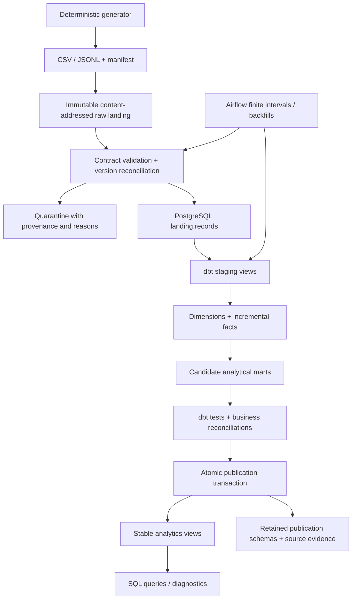

# Architecture and publication protocol

All business data is synthetic. Source files are delivered with checksummed manifests; CSV and JSONL represent independent producer contracts.

## Storage and model boundaries

Raw files remain immutable and linked by their content hash, schema version, source manifest, and ingestion run. Quarantine preserves the original payload and failure reason. `landing.records` stores the latest accepted version of each source business key; it is a durable canonical source layer, not the analyst interface. Catalog keys include their effective timestamp so meaningful dimension history is retained.

dbt staging models perform canonical SQL typing and preserve raw provenance. Dimensions assign history keys to effective intervals. Facts declare a single grain and join to the appropriate historical dimension version. Marts aggregate facts with explicit sales, refund, fulfillment, and inventory semantics. Refunds are aggregated before joining sales to prevent line multiplication.

## Candidate builds and quality gates

Each run acquires a PostgreSQL advisory lock and receives its own `build_<id>` schema. Incremental runs clone the previous physical model tables and indexes into that schema with `LIKE INCLUDING ALL` followed by an insert of the retained rows. This copies the full retained dataset rather than providing copy-on-write storage. The selected date partitions are removed and recomputed; this handles corrections that remove an old fact or shift its date as well as appended rows. Dimensions rebuild from source history. A full refresh reconstructs models from all canonical sources.

The runner executes dbt builds/tests against the candidate schema. `meta.reprocess_dates` records the dates selected for this run. Publication happens only after the full quality gate succeeds: a single database transaction redirects the stable `analytics` views to candidate model tables and records publication metadata. PostgreSQL transactions make the replacement visible as one committed change. Analysts using multiple statements should use a transaction with a consistent snapshot when they need every statement to observe the same publication.

An unsuccessful ingestion, transformation, test, or injected failure never advances the successful publication pointer. Previously published schemas remain queryable for as-published comparisons; accepted canonical source data and failed-run diagnostics remain available for recovery. Retries must reconcile the source state accepted since the last successful publication, including work accepted by an earlier failed attempt.

## Auditing and scheduling

The `meta` schema records run lifecycle, complete source manifests and generation seeds, source files and checksums, rejected payloads, selected dates, publications, and source evidence. An unresolved rejected partition remains a publication blocker until a clean redelivery resolves it. Diagnostics distinguish source-event dates, ingestion wall time, and the last-good analytical publication. Reference-data freshness can be evaluated against a declared reproducible as-of date; wall-clock recency is a different operational signal.

Airflow orchestrates finite daily intervals and explicit backfills. Its metadata is an isolated SQLite file in the optional local UI profile. A single BashOperator invokes the same CLI used in direct batch runs, keeping lock, retry, ingestion, and publication semantics in one application path. Airflow does not own a long-lived event consumer. A future streaming profile would land events durably before scheduled warehouse reconciliation.

## Official implementation references

- [Airflow local standalone and SequentialExecutor](https://airflow.apache.org/docs/apache-airflow/2.11.0/start.html)
- [Airflow data intervals](https://airflow.apache.org/docs/apache-airflow/2.11.0/core-concepts/dag-run.html)
- [dbt incremental models](https://docs.getdbt.com/docs/build/incremental-models)
- [Docker Compose profiles](https://docs.docker.com/compose/how-tos/profiles/)
