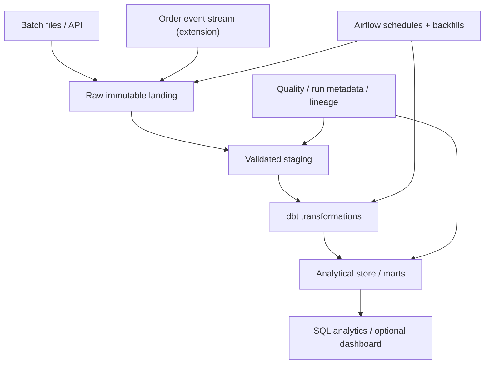

# Data Engineering & Analytics Platform — Project Idea Package

**Working name:** Commerce Operations Analytics Platform  
**Priority:** Conditional; build if substantial dedicated data-engineering/data-platform targeting continues and the Matroid/Visual Inspection portfolio does not adequately demonstrate warehouse-centered DE.  
**Status:** Concept and requirements only; no implementation prescribed or authorized by this brief.  
**Positioning:** Data Engineering, Analytics Engineering, Data Platform, and infrastructure-adjacent roles.

## 1. Project vision

Build an end-to-end, reproducible data platform for a fictional multi-location retail/commerce business. The platform combines historical transaction files, changing inventory and location records, and live order-lifecycle events into a trustworthy analytical dataset. Analysts can answer operational questions about revenue, refunds, fulfillment, and inventory without manually joining inconsistent source data.

The engineering centerpiece is **data correctness over time**: incremental loads, replayable backfills, schema changes, duplicate events, late arrivals, auditable transformations, and clear data-quality failures. The platform should make both *what the answer is* and *why the answer is trustworthy* inspectable.

All business data should be synthetic, deterministically generated, and clearly labeled. The project must not imply access to real employer/customer data.

## 2. Why this fills a distinct portfolio gap

Existing work already demonstrates reliable application/backend processing (Visual Inspection Platform), PostgreSQL and durable jobs (AI Security Platform), and analytical/ML datasets (Last.fm and market microstructure). This project should add the missing **warehouse and analytics-engineering lifecycle**:

- Orchestrated source ingestion across multiple changing source types.
- Source contracts, raw landing zones, incremental ELT, and backfills.
- Dimensional models, history tracking, SQL-defined business metrics, and lineage.
- Data tests, freshness SLAs, quarantine and reconciliations.
- Streaming-to-analytics integration, if the target job mix justifies it.
- Query-plan/performance evidence on reproducible synthetic workloads.

It should **not** become another API CRUD app, distributed queue, or visual-inspection extension under a different name.

## 3. Business scenario and questions

A fictional operator has many locations and separate POS, order-management, inventory, and location-catalog feeds. Raw feeds overlap and can disagree. Transactions may be corrected or refunded days later. Streams can repeat or arrive out of order. An analyst needs timely, stable answers to:

1. What was gross sales, discount amount, refund amount, and **net sales** by date and location?
2. Which locations have rising refund or cancellation rates?
3. What is the median and p95 time from paid order to fulfillment, by location?
4. Which products have high stockout frequency or inventory variance?
5. How do current metrics differ from the previous published dataset, and which source changes explain the delta?

Define business semantics before implementation. For example, **net sales = merchandise subtotal minus applied discounts minus attributable refunds**; do not silently include sales tax or tips. Refunds can arrive after the original sale date, so expose both event-time and reporting-as-of semantics where useful.

## 4. Inputs and data contracts

**Batch sources (core):**

- POS transactions and line items, delivered as dated CSV/Parquet files; corrections and duplicates possible.
- Daily inventory snapshots or adjustments per product and location.
- Location/product catalog with mutable descriptive attributes and effective timestamps.
- Optional paginated vendor API feed for promotions or returns to demonstrate cursor-based ingestion and rate limiting.

**Streaming source (later profile):** Order lifecycle events (`created`, `paid`, `fulfilled`, `cancelled`, `refunded`) from a deterministic event generator. Each has stable `event_id`, `order_id`, version/schema identifier, source event timestamp, and ingestion timestamp. Duplicates, delayed deliveries, and reordering can be deliberately injected.

Every source has an explicit schema contract, field definitions, null policy, primary/business key, timestamp convention, owner/producer name, and expected cadence. No real personal data is needed: use opaque synthetic IDs. Store source manifests/checksums and generation seeds for reproducibility.

## 5. Conceptual architecture

Keep **event ingestion** separate from **scheduled orchestration**: Airflow orchestrates finite loads, tests, and transformations, while a streaming consumer runs as a separate long-lived service. The streaming events can land in durable raw storage before an incremental warehouse refresh.

### Data layers

1. **Raw/bronze:** Append-only original payloads, partitioned by source and ingest date with a manifest, schema version, file hash, and processing-run identity.
2. **Validated/staging/silver:** Canonical types, time zones, identifiers, and deduplication rules; invalid records quarantined with actionable reasons. Preserve evidence linking rows to their raw provenance.
3. **Analytical/gold marts:** Stable fact/dimension models and documented metrics, rebuilt incrementally and queryable without knowledge of raw source peculiarities.

### Warehouse modeling

- `dim_location`, `dim_product`, optional `dim_date`.
- `fct_order_line`, `fct_refund`, `fct_fulfillment`, `fct_inventory_snapshot` or adjustment ledger.
- `mart_daily_location_sales`, `mart_refund_rate`, `mart_fulfillment_sla`, `mart_inventory_variance`.
- Demonstrate a type-2 slowly changing dimension for a meaningful attribute (e.g., product category or location region) *if historical-as-of questions actually need it*; otherwise document a simpler history model.

Clearly declare model **grain** (e.g., one row per order line, one row per refund event, or one row per location-product-day). Document join keys, uniqueness expectations, late-arriving updates, and the reconciliation rules that prevent double counting.

## 6. Technology direction and scope discipline

| Concern | Core recommendation | Optional role-driven extension |
|---|---|---|
| Programming | Python and SQL | PySpark when scale/distributed transformation evidence is needed |
| Orchestration | Apache Airflow | None unless role requirements justify replacement |
| Transformation | dbt with versioned SQL models and tests | More advanced semantic/metric layer |
| Analytical storage | Dedicated local PostgreSQL analytical database (separate from source/operational DB), with dbt-postgres | BigQuery/Snowflake, ClickHouse, or a lakehouse target if job postings repeatedly require one |
| Raw storage | Local files in the minimum version; S3-compatible object store as a profile | Cloud object storage deployment |
| Events | Deterministic local generator and durable landing | Kafka-compatible Redpanda/Kafka broker, consumer groups and offset management |
| Packaging | Docker Compose, pinned dependencies, CI | Infrastructure-as-code/cloud deployment only when valuable |
| Consumption | Versioned example SQL queries and metric documentation | Small dashboard (Metabase/Streamlit), not a large frontend |

The local PostgreSQL database is an **analytical store used for warehouse-style modeling**, not a claim to have used Snowflake/BigQuery or a distributed warehouse. Use a purpose-built warehouse only when it materially improves role relevance and the cost/operational burden is justified.

The required first complete version should run in a modest-memory **batch profile** without a broker, dashboard, Spark cluster, or Kubernetes. The streaming profile is isolated and opt-in. Given previously observed Windows laptop memory pressure, resource caps and clearly documented startup profiles are requirements.

## 7. Functional behavior

### Ingestion and transformation

- Initial historical import and subsequent incremental import of new/changed source partitions.
- Stable idempotency keys and atomic publication of successful partitions; repeat runs do not silently duplicate facts.
- Persisted ingestion/run state, source manifests, row counts, schema version, input checksum, and data window.
- Configurable bounded reprocessing windows for late data; explicit selected-date historical backfill.
- Distinguish source event time from arrival/load time; defined handling for out-of-order events.
- Controlled schema evolution: tolerate documented additive fields, reject or quarantine breaking changes, retain the original payload.
- SQL/dbt transformations from source models through facts/dimensions to final marts.
- Current-vs-historical business dimensions with clear as-of behavior.

### Quality, observability, and recovery

- Contract and dbt tests: `not_null`, `unique`, accepted values, referential integrity, nonnegative quantities where appropriate, and valid event transitions.
- Business invariants: no double-counted order lines/refunds; daily sales components reconcile to their atomic facts; inventory and fulfillment calculations use explicit definitions.
- Freshness and completeness checks by source/partition; thresholds declared in configuration.
- Bad-row quarantine with original source, failure reason, and retry/reprocessing path.
- Failed transformation or validation must not publish an apparently successful new mart snapshot.
- Run audit: source rows received/accepted/rejected, start/end time, data window, produced partitions, test outcomes, error category, and input manifests.
- Queryable diagnostics or a simple status view for freshness, lag, failure rate, last-good publication, and warehouse row-count deltas.

## 8. Demonstrations that prove engineering depth

Implement deterministic end-to-end scenarios, each with fixtures, assertions, and documented observed results:

1. **Replay:** Load a dated batch, replay the same batch, then prove identical fact and mart counts/totals.
2. **Late refund:** Publish a day's sales, ingest a refund several days later, reprocess the affected windows, and show corrected metrics without duplicate revenue.
3. **Schema drift:** Add a compatible field and verify continued ingestion; inject an incompatible type/change and verify quarantine or explicit failure.
4. **Partial failure:** Interrupt an incremental load or transformation, restart, and prove no partial mart publication and successful recovery.
5. **Backfill:** Rebuild a selected historical range and compare results with a clean full rebuild from the same inputs.
6. **Out-of-order event stream (extension):** Deliver `fulfilled` before a delayed `paid` event, plus duplicates, then show the specified deterministic state/metric resolution.
7. **Performance:** Run at least a small and a larger synthetic dataset; compare full-rebuild versus incremental runtime, rows processed/sec, memory peak, query latency, and scan behavior. Avoid unmeasured claims about speed or scale.

Version a small reference dataset with exact expected analytics answers to make data correctness demonstrable in CI. Larger datasets should be reproducibly generated, not committed in full.

## 9. Suggested project boundaries and evolution

**Core complete project (resume-worthy):** Batch ingestion from at least two distinct source types; raw/validated/mart layers; Airflow DAGs; dbt transformations and tests; incremental load/backfill; reconciliation and fault-injection examples; SQL analytics; one reproducible benchmark; Docker and CI.

**Extension A — Streaming analytics:** Kafka-compatible broker, event producer, consumer with durable offsets/idempotent warehouse landing, bounded late-event reconciliation, and freshness/lag metrics. This is the preferred extension for dedicated data-platform positions requiring streaming.

**Extension B — Cloud warehouse / distributed processing:** Choose *one* path based on job descriptions: e.g., S3 + BigQuery/Snowflake for warehouse engineering, or Parquet + Spark for distributed batch processing. Do not add both solely for keyword coverage.

**Extension C — CDC/OLAP:** Genuine source database change-capture or ClickHouse serving layer, only if repeated target roles stress these technologies and earlier extensions do not already cover them.

Avoid a separate frontend framework, a mock machine-learning model, a Kubernetes cluster, multiple stream brokers, or a complex microservice fleet as initial requirements. These would obscure the DE learning outcome.

## 10. Deliverable and presentation expectations

- A clear README with problem, business definitions, architecture, bounded scope, technology choices, and 10-minute local demo.
- One-command reproducible **batch profile**; optional separately named streaming profile.
- Source contracts, data dictionary, dbt documentation/lineage, and SQL examples with expected outcomes.
- Architecture and data-flow diagrams distinguishing raw ingestion, transformation, publication, and quality gates.
- Deterministic seed data and fault-injection scripts, all identified as synthetic.
- Automated tests in CI, including data quality and incremental/backfill parity.
- A benchmarks/evidence report listing dataset sizes, hardware/runtime context, method, repeated measurements, and limitations.
- A short design-tradeoffs note: local analytical PostgreSQL vs cloud warehouse; event-time corrections; at-least-once ingestion vs end-to-end exactly-once claims.
- No credentials, employer identifiers, or customer data committed to Git.

## 11. Completion criteria

Consider the core ready when a reviewer can clone it, run a sample pipeline, inspect Airflow and dbt models, execute analytics queries, inject duplicates/late corrections/failures, rerun a backfill, and confirm deterministic results from tests. The repo must demonstrate a *real lineage from noisy sources to validated, modeled analytics*.

Streaming is not required for the core completion gate. If streaming is promoted into scope for target DE/platform postings, its correctness and recovery demonstrations become required for that variant.

## 12. Conditional build decision and resume positioning

**Do not delay current DE applications for this project.** Existing systems and data work already provide credible entry-level examples. Build this separate platform if a meaningful share of imminent applications are dedicated DE/analytics-engineering/data-platform roles, repeated postings specifically demand Airflow/dbt/warehousing/stream processing, and Matroid's own ingestion component does not supply comparable proof without diluting its computer-vision focus.

This would most directly strengthen the **Data Engineering** and **Data Engineering / AI** resumes, with selective relevance to backend platform roles. It is less valuable on a general SWE, security, or C++ quant-systems resume unless a job description emphasizes data infrastructure.

Potential resume bullet *shapes* (replace placeholders with verified observations only):

- Developed an Airflow-orchestrated, dbt-modeled analytics pipeline ingesting **[N] synthetic records** across **[X] source types**, with incremental backfills and **[specific correctness evidence]**.
- Implemented **[N] data quality and reconciliation checks** across **[models]**, validating replay/late-event recovery and preventing **[observed class of double-counting]**.
- Reduced **[measured pipeline or query runtime]** by **[measured percent]** through incremental processing and **[verified query/model change]**.

Do not invent a performance percentage or call synthetic traffic production/customer traffic.

## 13. Technical references (official)

- Airflow backfill and rerun semantics: https://airflow.apache.org/docs/apache-airflow/stable/core-concepts/backfill.html
- Airflow DAG data intervals: https://airflow.apache.org/docs/apache-airflow/stable/core-concepts/dags.html
- dbt incremental models: https://docs.getdbt.com/docs/build/incremental-models
- dbt tests: https://docs.getdbt.com/docs/build/data-tests
- dbt incremental vs snapshots/history: https://docs.getdbt.com/best-practices/how-we-handle-cdc/2-choosing-incremental-or-snapshots
- dbt PostgreSQL connector: https://docs.getdbt.com/docs/local/connect-data-platform/postgres-setup
- Redpanda/Kafka-compatible local streaming: https://docs.redpanda.com/streaming/current/get-started/quick-start/

*This is an idea and acceptance-definition package, not an implementation-agent prompt or a phase-by-phase approval workflow.*
